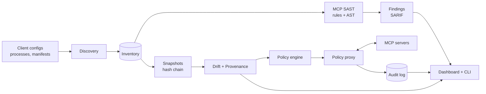

<div align="center">


<br>

**A self-hostable single pane of glass for securing Model Context Protocol servers.**
Discovery, MCP-aware static analysis, drift and provenance tracking, and an optional least-privilege proxy, in one place.

<br>


</div>

---

## Why MCP-SPM?

The MCP ecosystem is growing faster than its security tooling.

- Generic SAST tools do not model MCP artifacts such as tool descriptions, input schemas, and permission scopes.
- Path traversal and weak input validation are common in MCP servers, and many internet-exposed servers have no authentication.
- Existing tools are either static scanners or runtime proxies. Few give you one posture view across both.

MCP-SPM treats tool metadata as a first-class attack surface and ties together everything you need to decide whether a server should be trusted, and to notice when that trust should be revoked.

## How it works

<div align="center">

</div>

| # | Module | What it does |
|---|--------|--------------|
| 1 | **Discovery and inventory** | Finds servers in Claude Desktop, Claude Code, Cursor, VS Code, and Windsurf configs, running processes, docker-compose and Kubernetes manifests, and allowlisted hosts. Enumerates tools, resources, and prompts over stdio, SSE, and streamable HTTP. |
| 2 | **MCP-aware SAST** | Detects tool poisoning, shadowing, over-privileged capabilities, weak schemas, and handler bugs. Rule engine (YAML) plus tree-sitter AST analysis for Python, TypeScript, and Go. Outputs SARIF mapped to OWASP LLM Top 10, MITRE ATLAS, and CWE. |
| 3 | **Drift and provenance** | Content-addressed, hash-chained snapshots of every approved server. Alerts on any post-approval change and requires human re-approval. Verifies publishers, sigstore signatures, and SLSA attestations, and flags typosquats. |
| 4 | **Policy proxy** *(optional)* | MCP-protocol proxy that enforces least privilege derived from the approved snapshot. Modes: monitor, dry-run, enforce. Every decision goes to an audit log. |
| 5 | **Dashboard and CLI** | Fleet and per-server posture scores, findings, drift timeline, provenance badges, approval workflow, and a policy editor. CI mode with a GitHub Action. |

## Catching a rug pull

A server is approved, behaves normally, then quietly changes a tool description. MCP-SPM compares each snapshot against the approved one, flags the change, and the proxy blocks calls to the drifted tool until a human re-approves it.

<div align="center">

</div>

## Quickstart

> The commands below are the target interface. Check the roadmap for what is implemented so far.

```bash
git clone https://github.com/YOUR-USERNAME/mcp-spm.git
cd mcp-spm
uv sync

mcpspm discover                      # inventory MCP servers on this machine
mcpspm scan --all                    # static analysis, SARIF to ./reports
mcpspm approve filesystem-docs       # snapshot and trust a server
mcpspm diff filesystem-docs          # compare current state to the approved snapshot
mcpspm proxy --policy policies/filesystem-docs.yaml --mode enforce
mcpspm report --format sarif
```

Run the full stack:

```bash
docker compose up
# API  -> http://localhost:8000
# UI   -> http://localhost:5173
```

## CLI

| Command | Purpose |
|---------|---------|
| `mcpspm discover` | Build the server inventory from configs, processes, manifests, and allowlisted hosts |
| `mcpspm scan` | Run rules and AST analysis, emit findings and posture scores |
| `mcpspm approve` | Record a human-approved, hash-chained snapshot |
| `mcpspm diff` | Show semantic differences from the approved snapshot |
| `mcpspm proxy` | Run the policy enforcement proxy |
| `mcpspm report` | Export SARIF, JSON, or HTML reports |

**CI mode:** `mcpspm scan --ci` exits nonzero on policy violations or unapproved drift. A GitHub Action is included under `action/`.

## Policy as code

Policies are generated from the approved snapshot, then tightened by you.

```yaml
server: filesystem-docs
mode: enforce            # monitor | dry-run | enforce
on_drift: block
tools:
  allow: [read_file, list_directory]
arguments:
  read_file:
    path:
      root: /srv/docs
      deny_traversal: true
network:
  egress: deny           # declared scope was filesystem only
rate_limit:
  calls_per_minute: 60
```

## Detection rules

33 rules across seven categories, each with a positive and a negative test fixture. Full schema in [`docs/RULE_SPEC.md`](docs/RULE_SPEC.md).

<details>
<summary><b>Rule categories</b></summary>

| Category | Examples |
|----------|----------|
| `DISC` Discovery and config | No auth, plaintext HTTP, 0.0.0.0 binding, hardcoded secrets, unpinned launch commands |
| `POIS` Tool poisoning | Injection phrasing, invisible Unicode, exfiltration directives, hidden schema instructions, name shadowing |
| `PRIV` Over-privilege | Filesystem, network, or shell access beyond what the tool declares |
| `SCHEMA` Weak schemas | Unbounded path strings, unconstrained URLs, free-form command arguments |
| `CODE` Handler bugs | Path traversal, command injection, SSRF, unsafe deserialization, SQL injection |
| `DRIFT` Drift | Description changed, schema widened, package hash changed, tools added or removed |
| `PROV` Provenance | Missing signatures, typosquats, maintainer changes, missing attestations |

</details>

## Architecture



See [`docs/ARCHITECTURE.md`](docs/ARCHITECTURE.md) and [`docs/THREAT_MODEL.md`](docs/THREAT_MODEL.md) for details.

## Safety principles

- **Defensive use only.** Remote hosts are scanned only when explicitly allowlisted in `config/targets.allow.yaml`.
- **Tool text is hostile input.** Descriptions and schemas are never passed to an LLM as instructions. Optional LLM triage treats them strictly as quoted data and cannot approve anything.
- **Sandboxed analysis.** Untrusted server code only runs inside a container with no network, a read-only filesystem, and resource limits.
- **Humans approve.** No automated path can re-approve a drifted server.
- **Fail closed.** In enforce mode, unknown tools, unparseable messages, and drifted definitions are blocked and logged.

## Test assets

- `fixtures/vulnerable_server/`: a deliberately vulnerable MCP server for testing detections. Binds to loopback only. Never expose it.
- `fixtures/rugpull_sim/`: a server that serves benign definitions, then silently changes them, for drift and proxy tests.

## Roadmap

- [x] Architecture, threat model, and rule specification
- [ ] M1: Discovery and `discover` command
- [ ] M2: Static analysis, rule engine, SARIF, 20+ rules
- [ ] M3: Snapshots, hash chain, semantic diff, provenance
- [ ] M4: Policy proxy with audit log
- [ ] M5: Dashboard, GitHub Action, demo script
- [ ] Later: registry integration, SIEM export, agent-framework plugins, Rego policies

## Contributing

Contributions are welcome. Every new rule needs a YAML definition plus positive and negative fixtures, and CI enforces this. See [`CONTRIBUTING.md`](CONTRIBUTING.md). To report a vulnerability in MCP-SPM itself, see [`SECURITY.md`](SECURITY.md).

## License

MIT. See [`LICENSE`](LICENSE).

<div align="center">
<sub>Built to make the MCP ecosystem safer to adopt.</sub>
</div>
