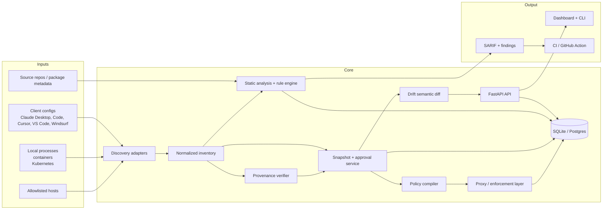

# MCP-SPM Architecture

This document defines the M0 architecture for MCP-SPM. It intentionally describes the system boundary and component layout without implementing feature logic.

## Goals
- Discover and inventory MCP servers, their transport methods, and security posture.
- Scan tool metadata, schemas, source code, and runtime config using threat-aware rules.
- Detect drift and provenance changes after server approval.
- Offer an optional policy proxy that enforces allowed tools and constrained arguments.
- Present a single self-hosted operational view for fleet and per-server posture.

## High-level system context



## Component map

### 1. Discovery
Responsible for enumerating candidate MCP servers and collecting inventory data.

Scope:
- Client config parsing from Claude Desktop, Claude Code, Cursor, VS Code, Windsurf.
- Runtime process discovery and container inspection.
- Compose and Kubernetes manifest analysis.
- Transport detection: stdio, SSE, streamable HTTP.
- Tool, prompt, and resource enumeration where allowed.

Security rules:
- Discovery does not execute code automatically.
- External hosts are not scanned without explicit allowlisting.
- Observed endpoint details are normalized as untrusted data.

### 2. Inventory model
The inventory layer creates a canonical object model for each server and MCP artifact.

Entities:
- Server
- ToolDefinition
- ResourceDefinition
- PromptDefinition
- Observation
- Snapshot
- ApprovalRecord
- Finding
- PolicyDefinition

Key fields:
- Server id, name, host, port, transport, auth state, launch metadata.
- Tool metadata: name, description, input schema, scopes, tags, version.
- Artifact hashes and canonical JSON representations.
- Observation timestamps and source adapter metadata.

### 3. Static analysis and rule engine
Runs rules against tool metadata, source files, and generated schemas.

Inputs:
- YAML rules in `rules/`
- AST data from Python, TypeScript, and Go source using tree-sitter.
- Structured schema objects extracted from tool definitions.
- Optional provider- or classifier-based semantic review.

Outputs:
- Findings with canonical semantics and mappings.
- SARIF 2.1.0 output.
- Scores for each server and aggregated fleet posture.

Important constraints:
- Tool descriptions and schema text are hostile input and handled as quoted data.
- LLM triage is optional and never allowed to trigger approvals or tool execution.
- Rules are deterministic first; semantic-only conclusions are advisory.

### 4. Drift and approval service
Stores canonical snapshots of tool metadata, schemas, and server state; records approval decisions.

State machine concept:
- `unknown` -> `observed` -> `approved` -> `drifted` -> `reapproved`.
- Any post-approval mutation in description, schema, version, or trust profile moves the server to `drifted`.
- Only a human can re-approve a drifted server.

### 5. Provenance and trust
Verifies package identity and trust metadata for server artifacts and their dependencies.

Checks:
- Publisher and maintainer identity.
- Registry metadata and package signatures.
- Sigstore or cosign attestations.
- SLSA provenance.
- Typosquat or ownership drift detection.

Result:
- A trust score and provenance evidence chain attached to the server snapshot.

### 6. Policy proxy
Optional runtime enforcement layer between clients and MCP servers.

Modes:
- `monitor`: log and report without blocking.
- `dry-run`: evaluate policy decisions without enforcement.
- `enforce`: block unknown tools, malformed messages, drifted definitions, or disallowed network paths.

The proxy should use the last approved snapshot to build a policy model; it must fail closed when state is unknown.

### 7. API and dashboard
A self-hosted API and UI for fleet posture, approvals, drift timeline, and policy review.

Responsibilities:
- Display server posture and trust score.
- Show findings by severity and due to drift or provenance.
- Provide approval workflow and audit trail.
- Offer policy editing with YAML-first schema definitions.

### 8. Plugin architecture
MCP-SPM should use entry points and narrow interfaces instead of hardwired modules.

Supported plugin types:
- `mcpspm.rules` — detection rules and rule metadata.
- `mcpspm.discoverers` — discovery adapters.
- `mcpspm.exporters` — SARIF or other report exporters.

Plugin contract:
- Each plugin is deterministic, typed, and isolated from runtime execution.
- Plugins receive canonical inventory objects, never raw hostile text directly without sanitization.
- Plugins must declare schema version and metadata to support compatibility checks.

## Storage model

The initial storage strategy is SQLite with an option to move to PostgreSQL. Use a domain-oriented schema with immutable records where appropriate.

```sql
-- server inventory
servers (
  id TEXT PRIMARY KEY,
  name TEXT NOT NULL,
  transport TEXT NOT NULL,
  host TEXT,
  port INTEGER,
  auth_state TEXT,
  endpoint TEXT,
  launch_metadata JSON,
  posture_score INTEGER,
  approval_state TEXT,
  created_at TIMESTAMP,
  updated_at TIMESTAMP
);

-- normalized artifacts
artifacts (
  id TEXT PRIMARY KEY,
  server_id TEXT NOT NULL,
  kind TEXT NOT NULL, -- tool, resource, prompt, config, package
  name TEXT NOT NULL,
  description TEXT,
  schema JSON,
  version TEXT,
  content_hash TEXT NOT NULL,
  canonical_json TEXT NOT NULL,
  created_at TIMESTAMP
);

-- historical snapshots
snapshots (
  id TEXT PRIMARY KEY,
  server_id TEXT NOT NULL,
  parent_snapshot_id TEXT,
  asset_hash TEXT NOT NULL,
  canonical_json TEXT NOT NULL,
  chain_hash TEXT NOT NULL,
  created_at TIMESTAMP,
  approved_by TEXT,
  approved_at TIMESTAMP
);

-- findings
findings (
  id TEXT PRIMARY KEY,
  server_id TEXT NOT NULL,
  rule_id TEXT NOT NULL,
  severity TEXT NOT NULL,
  confidence TEXT NOT NULL,
  tool TEXT,
  location TEXT,
  evidence TEXT,
  mappings JSON,
  remediation TEXT,
  fingerprint TEXT,
  created_at TIMESTAMP
);

-- provenance
provenance (
  id TEXT PRIMARY KEY,
  server_id TEXT NOT NULL,
  package_name TEXT,
  publisher TEXT,
  registry TEXT,
  signature_valid BOOLEAN,
  slsa_valid BOOLEAN,
  typosquat_risk BOOLEAN,
  trust_score INTEGER,
  evidence JSON,
  created_at TIMESTAMP
);

-- approvals and policy
approvals (
  id TEXT PRIMARY KEY,
  server_id TEXT NOT NULL,
  snapshot_id TEXT NOT NULL,
  approver TEXT NOT NULL,
  reason TEXT,
  decision TEXT NOT NULL,
  created_at TIMESTAMP
);

policies (
  id TEXT PRIMARY KEY,
  server_id TEXT NOT NULL,
  version TEXT NOT NULL,
  mode TEXT NOT NULL,
  rules JSON NOT NULL,
  created_at TIMESTAMP
);

-- audit log
audit_events (
  id TEXT PRIMARY KEY,
  actor TEXT,
  target TEXT,
  action TEXT NOT NULL,
  result TEXT NOT NULL,
  details JSON,
  created_at TIMESTAMP
);
```

## Data flow and boundaries

1. Discovery adapters collect metadata from installed clients, manifests, running processes, and allowlisted endpoints.
2. Normalization turns those sources into a common inventory format.
3. Analysis engines evaluate tool metadata, code, and server config for threats.
4. Snapshots are created from normalized inventory after successful indexing or scanning.
5. The approval service marks snapshots as reviewed and trusted.
6. Drift detection compares current state to the last approved snapshot.
7. The policy proxy derives enforcement rules from the approved snapshot.
8. Audit events record all enforcement and approval actions.

## M0 scope boundary

M0 includes:
- architecture and component design
- threat model and STRIDE analysis
- data model and plugin API specification
- repo skeleton required for upcoming milestones

M0 excludes:
- business logic implementations
- rule execution engines
- transport clients and collectors
- policy enforcement logic
- dashboard and API runtime code

## Open technical decisions

The following are intentionally left open for later milestone scoping:
- exact choice of SQLAlchemy model organization for discovery vs. analysis vs. drift
- whether to store all canonical JSON and hash chain fields in the same table or split them by domain
- whether the policy proxy should be a sidecar service or integrated into the API process
- exact location of rule loaders and plugin registries within the Python package
