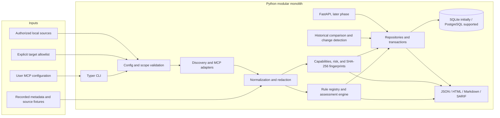

# MCP-SPM Architecture

This M0 architecture describes a CLI-first defensive security posture manager implemented as a Python modular monolith. It specifies boundaries and data flow, not completed functionality.

## Goals and operating modes
- Discover MCP server assets from user-supplied configuration and authorized local sources.
- Assess MCP configuration, server metadata, tool capabilities, and source evidence using modular rules.
- Fingerprint canonical tool definitions and compare them with trusted historical observations.
- Persist findings and assessment history in SQLite initially, with PostgreSQL supported behind the storage layer.
- Produce evidence-based remediation guidance and JSON, HTML, Markdown, and SARIF reports.
- Add continuous monitoring and a REST API after the CLI foundation; a dashboard is a later objective.

Assessment modes:
1. **Static** (default): parse configuration and recorded metadata without starting or connecting to an MCP server.
2. **Active**: connect to an explicitly authorized server to inspect protocol capabilities. Remote targets require an entry in `config/targets.allow.yaml`; default allowlist is empty. Local stdio is not an HTTP endpoint and must not be reported as failing HTTP authentication checks.
3. **Isolated dynamic**: opt-in controlled testing in a disposable sandbox. Never execute untrusted server code on the host. Sandbox requirements include no network by default, read-only filesystem, dropped capabilities, resource limits, and explicit network authorization where needed.

## High-level architecture



## Component responsibilities

### CLI and core pipeline
The CLI is the initial user interface and orchestrates a typed pipeline: load input, validate configuration and scope, normalize/redact, discover only when authorized, assess, calculate contextual risk, persist, and report. Validation errors must stop execution before any network request or process launch. Commands and options must clearly identify which mode can connect or execute.

### Discovery and inventory
Discovery adapters parse supported MCP configuration formats and, in later approved phases, connect through supported transports using the official MCP SDK. The inventory represents servers, transport, endpoint/launch metadata, authentication observations, tools, resources, prompts, schemas, and source provenance. Parsing and normalization are bounded and non-executing; discovered launch commands are data, never automatically invoked.

### Assessment and rule registry
Rules are modular, typed, uniquely identified, and loaded from the project rule catalog. Initial rule families are exposed secrets, authentication controls, excessive permissions, command execution capability, suspicious descriptions, schema modifications, insecure transport, supply-chain risks, sensitive information exposure, and insufficient auditing. Rules return evidence, confidence, severity, exploitability, impact, exposure, and remediation. A transport-aware rule must distinguish stdio from network transports.

Rule execution is deterministic by default. Tool-provided text remains untrusted throughout parsing, rule evaluation, reporting, and any optional triage. Parser and detector limits prevent adversarial inputs from consuming unbounded resources.

### Capability analysis and fingerprinting
Capability analysis summarizes filesystem, network, process/command, and other declared or detected operations. Canonicalization must be deterministic and versioned. SHA-256 fingerprints identify exact canonical tool definitions for comparison; they do not prove package publisher identity or benign behavior. Historical changes are shown with their provenance and require human review before trust is restored.

### Risk scoring
Each finding records severity, exploitability, impact, exposure, confidence, and remediation. CVSS is included when an applicable vulnerability can be responsibly mapped; contextual MCP risks use a transparent, versioned project model and must not be mislabeled as CVSS. Store the inputs and rationale so scores can be reproduced. Aggregate posture scores must not hide underlying findings or imply certainty.

### Storage and persistence
SQLAlchemy models and repositories isolate domain code from SQLite/PostgreSQL details. Use Alembic for schema migrations and transactions for related scan, finding, evidence, and fingerprint writes. Persist secrets neither as raw fields nor as unredacted evidence. Store unique finding-instance IDs separately from rule IDs. Database access is local by default; API authorization is required before exposing it over a network.

### Monitoring
Recurring assessments, new-server detection, configuration monitoring, alerts, and remediation status are later-phase services. Scheduling must reuse the same authorization and scope validation as manual scans. A change detector compares historical fingerprints and assessments; it cannot approve changes.

### Reporting
Report serializers consume validated domain results and produce JSON, HTML, Markdown, and SARIF. HTML output must escape untrusted descriptions and evidence. All formats apply secret redaction, evidence truncation, and stable finding identifiers. Reports distinguish observed facts from inferred risk and include limitations.

### REST API and later dashboard
FastAPI is a later phase, after the CLI and domain interfaces stabilize. It should call the same application services as the CLI, validate requests with Pydantic, authenticate API users, enforce authorization, and avoid exposing secrets. The web dashboard is explicitly later than the initial CLI/API milestones.

## Data model

Logical entities (physical SQLAlchemy table names are lower snake case):

- **Server** (`servers`): stable asset ID, display name, transport, redacted endpoint/launch metadata, source, exposure/auth observations, and timestamps.
- **Scan** (`scans`): unique scan ID, server/config scope, mode, tool/rule versions, status, timestamps, and summary. Never record a scan as completed if it failed or was not run.
- **Tool** (`tools`): server ID, tool name, sanitized description, canonical schema, annotations/capability summary, canonicalization version, and SHA-256 fingerprint. Resources and prompts may be represented as typed inventory artifacts or additional tables, subject to migrations.
- **Finding** (`findings`): unique finding-instance ID, rule ID, scan ID, optional server/tool IDs, severity, confidence, risk inputs, remediation, status, and stable deduplication fingerprint.
- **Evidence** (`evidence`): finding ID, location, redacted and bounded evidence, evidence type, and source reference. Raw secrets are never persisted.
- **Fingerprint** (`fingerprints`): server/tool/config subject, canonical digest, algorithm and canonicalization version, observation time, and optional human-trusted baseline reference.

Relationships: a server has scans and tools; a scan has findings; a finding has evidence; fingerprints are historical observations for a server, tool, or configuration. Rule IDs identify detection logic and are not finding primary keys. Database transactions must keep one scan's findings/evidence consistent.

## Plugin and extension interfaces

Keep a modular monolith initially. Define narrow, typed interfaces for discovery adapters, assessment rules, and report exporters. Each extension declares an identifier, supported input/schema version, and metadata; it receives normalized, redacted domain objects. Loading an extension must not execute a discovered MCP server. Plugin API versioning and trust policy are implementation decisions for the foundation phase; untrusted third-party plugins must not be loaded implicitly.

## Security boundaries and failure behavior

- Parse input without executing it; reject unsupported or ambiguous config structures safely.
- Validate remote target authorization and resolved network addresses before active requests. Defend against SSRF, DNS rebinding, redirects to unauthorized destinations, and private/link-local/metadata addresses unless explicitly authorized by policy.
- Apply connection/read timeouts, response-size limits, bounded concurrency, and schema/text depth limits.
- Do not follow redirects or resolve a hostname to a new address without re-validating scope.
- Do not invoke arbitrary commands by default; stdio connection launch requires explicit user intent and safe, validated launch configuration.
- Static assessment remains available without network access.
- Isolated dynamic mode is disabled by default and must reject environments that do not meet sandbox requirements.
- On malformed or oversized responses, stop safely and report an assessment error rather than interpreting partial content as trusted.

## Repository layout

```text
.
├── src/mcp_spm/
│   ├── cli/                 # Typer entry points and commands
│   ├── core/                # Settings, pipeline, errors, domain orchestration
│   ├── discovery/           # Config parsing, inventory, MCP transports
│   ├── assessment/          # Engine, rule contracts, registry, checks
│   ├── analysis/            # Behavior, canonicalization, fingerprints, risk
│   ├── monitoring/          # Scheduling, change detection, alerts (later)
│   ├── storage/             # SQLAlchemy models, migrations integration, repositories
│   ├── reporting/           # JSON, HTML, Markdown, SARIF exporters
│   └── api/                 # FastAPI app and routes (later)
├── rules/
├── tests/{unit,integration,security,fixtures}/
├── docs/
├── examples/{configurations,sample-reports}/
└── .github/{ISSUE_TEMPLATE,workflows}/
```

## Delivery boundary

M0 is architecture, data model, threat model, and repository skeleton documentation only. It does not claim that discovery, scanning, persistence, reports, monitoring, or API features are implemented. The staged product roadmap is foundation/CLI, discovery, detection, risk and persistence, reporting, monitoring/API, then hardening/release; detailed scope and gates should be maintained in the roadmap documentation.
